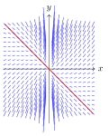
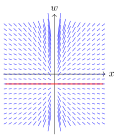

Se já sabemos resolver EDOs primeira ordem separáveis, podemos desenvolver métodos de mudanças de variáveis de modo a obtermos um novo problema cuja técnica já é conhecida. O exemplo mais simples, reduzindo a equações separáveis, é o que vamos estudar hoje.

::: {#def-a04-1}
Uma EDO de primeira ordem é dita **homogênea** se pode ser escrita no formato $$y'=f\left(\dfrac{y}{x}\right),$$ ou seja, $y'$ é uma expressão em que apenas aparece o bloco $\dfrac{y}{x}$. Numa equação homogênea, jamais é possível encontrar $x$ ou $y$ isolados. Sempre aparecem juntos como a fração $\dfrac{y}{x}$.
:::

É bastante comum que equações homogêneas também não sejam de outros tipos, embora isto possa acontecer. Também é bastante comum que a sua escrita não esteja diretamente no formato desejado, demandando que saibamos reconhecê-la e reescrevê-la.

::: {#exm-a04-1}
$\displaystyle y'=\dfrac{x+y}{x-y}$ pode ser reescrita para o formato desejado, bastando dividir cada termo do numerador e do denominador por $x$ (e considerando que $x \neq 0)$:

$$y'=\dfrac{x+y}{x-y}= 
        \dfrac{\dfrac{x}{x}+\dfrac{y}{x}}{\dfrac{x}{x}-\dfrac{y}{x}}=\dfrac{1+\left(\dfrac{y}{x}\right)}{1-\left(\dfrac{y}{x}\right)}$$
:::

::: {#exm-a04-2}
$\displaystyle y'=\dfrac{x^2+y^2}{x^2-xy+y^2}$ também pode ser reescrita. Mas como todos os monômios da expressão são quadráticos, dividimos cada trecho por $x^2$ (novamente, considerando que $x \neq 0$).

$$y'=\dfrac{x^2+y^2}{x^2-xy+y^2}=
        \dfrac{\dfrac{x^2}{x^2}+\dfrac{y^2}{x^2}}{\dfrac{x^2}{x^2}-\dfrac{xy}{x^2}+\dfrac{y^2}{x^2}}=\dfrac{1+\left(\dfrac{y}{x}\right)^2}{1-\left(\dfrac{y}{x}\right)+\left(\dfrac{y}{x}\right)^2}$$
:::

::: {#exr-a04-1}
Indique se as equações a seguir são homogêneas ou não.

a)  $y'=\dfrac{2xy^2-y^3}{x^2y}$
b)  $y'=\dfrac{3y\sqrt{x}}{x\sqrt{y}}$
c)  $y'=\dfrac{\ln (x^2+y^2)}{\ln xy}$
d)  $y'=\ln x^2 - 2\ln y$
:::

Uma vez que a função esteja organizada em termos de $\dfrac{y}{x}$, podemos aplicar uma mudança de variáveis para obter uma nova função mais simples de resolver que estas.

Caso tomemos uma nova função $w(x)=\dfrac{y}{x}=\dfrac{y(x)}{x}$, podemos construir uma nova equação diferencial em termos de, apenas, $w$ e $x$.

Como nossa EDO tem o formato $\displaystyle y'=f\left(\dfrac{y}{x}\right)$, a mudança de variável $w=\dfrac{y}{x}$ a transforma em $f(w)$, ou seja, a expressão do lado direito depende apenas de $w$. Mas o que acontece com o $y'$ do lado esquerdo?

Da regra do produto das derivadas, temos que $$w=\dfrac{y}{x} \implies y=xw \implies y'=(xw)'=(x)'\cdot w + x\cdot (w)'=w+xw'.$$

Então, ao organizar todos termos, temos que as EDOs a seguir são equivalentes:

$$y'=f\left(\dfrac{y}{x}\right) \iff w+xw'=f(w)$$

Indo além, podemos organizar ainda mais os termos:

$$w+xw'=f(w) \iff xw'=f(w)-w \iff \dfrac{w'}{f(w)-w}=\dfrac{1}{x} \iff \dfrac{dw}{f(w)-w}=\dfrac{dx}{x},$$ que é uma EDO separável!

Assim, caso a EDO original seja homogênea, podemos aplicar uma mudança de variáveis para obter uma equação separável com $w$ e $x$ e resolvê-la para, ao fim, retornar a $y$ e $x$.

::: {.callout-note title="Retorno ao Exemplo 01"}
Para resolver $\displaystyle y'=\dfrac{x+y}{x-y}$, primeiramente organizamos os termos para escrevê-la dependente dos quocientes $\dfrac{y}{x}$. Isto já foi feito antes: $$y'=\dfrac{x+y}{x-y}= \dfrac{1+\left(\dfrac{y}{x}\right)}{1-\left(\dfrac{y}{x}\right)}$$

Em seguida, aplicamos a mudança de variável $w=\dfrac{y}{x}$, substituindo a expressão da equação e trocando $y'$ por $w+xw'$:
:::

::: caixa
$$w+xw'=\dfrac{1+w}{1-w} \implies xw'=\dfrac{1+w}{1-w}-w\cdot \dfrac{1-w}{1-w}=\dfrac{1+w-w(1-w)}{1-w}=\dfrac{1+w^2}{1-w}$$ $$\iff w' = \dfrac{1+w^2}{1-w}\cdot \dfrac{1}{x}$$

Agora que obtivemos uma equação separável, observamos as soluções constantes. Neste caso, como $1+w^2$ é sempre positiva, não temos soluções deste tipo neste exemplo.

Em seguida, separamos as variáveis.

$$w' = \dfrac{1+w^2}{1-w}\cdot \dfrac{1}{x} \iff \dfrac{1-w}{1+w^2} \ dw = \dfrac{1}{x} \ dx \implies \int \dfrac{1-w}{1+w^2} \ dw = \int \dfrac{1}{x} \ dx$$

Resolvendo as integrais, obtemos:

- $\displaystyle \int \dfrac{1-w}{1+w^2} \ dw = \int \dfrac{1}{1+w^2} \ dw - \dfrac{1}{2}\int \dfrac{2w}{1+w^2} \ dw = \arctan w - \dfrac{\ln(1+w^2)}{2}$
- $\displaystyle \int \dfrac{1}{x} \ dx = \ln x+c_1$

Juntamos as partes e substituímos de volta $w=\dfrac{y}{x}$. $$\int \dfrac{1-w}{1+w^2} \ dw = \int \dfrac{1}{x} \ dx \implies \arctan w - \dfrac{\ln|1+w^2|}{2} = \ln x+c_1$$ $$\arctan \left(\dfrac{y}{x}\right) - \dfrac{\ln\left|1+\left(\dfrac{y}{x}\right)^2\right|}{2} = \ln x+c_1$$

Opcionalmente, podemos organizar um pouco mais os termos (embora a solução implícita acima já seja aceitável): $$\arctan \left(\dfrac{y}{x}\right) - \dfrac{\ln\left(1+\left(\dfrac{y}{x}\right)^2\right)}{2} = \ln x+c_1 \iff 2\arctan \left(\dfrac{y}{x}\right) = \ln\left(x^2+y^2\right)+c$$ é a solução implícita desta EDO, com $c=2c_1 \in \mathbb{R}$.
:::

::: {#exr-a04-2}
Resolva a equação diferencial dada usando uma substituição apropriada.

a)  $\dfrac{dy}{dx}=\dfrac{y}{x}+\dfrac{x}{y}$
b)  $y'=\dfrac{x}{2x-y}$
c)  $xy'-y=\sqrt{x2+y^2}$
d)  $\dfrac{dy}{dx}=\dfrac{y}{x}\ln \dfrac{y}{x}$
:::

Uma observação interessante: o que acontece com as soluções constantes da EDO separável que surge durante o procedimento?

As soluções constantes, caso existam, são constantes com relação à variável auxiliar $w$, ou seja, são da forma $w=k$.

Retornando a $x$ e $y$, isto equivale a encontrar soluções da forma $y=kx$. Como $y'=w+xw'$, então, para estas soluções constantes, tem-se $y=k+x\cdot 0=k$.

Portanto, as soluções constantes das EDOs separáveis equivalentes ao problema homogêneo dado equiparam-se a soluções oblíquas da forma $y=kx$.

::: {#exm-a04-3}
A EDO homogênea $y'=\dfrac{x+2y}{x}$ equivale à EDO separável $w'=\dfrac{1+w}{x}$, que admite a solução constante $w=-1$. Esta solução equivale às retas oblíquas $y=-x$, soluções da equação original.

::: {layout-ncol="2"}
{.tikz fig-alt="Campo de direções de y′ = (x + 2y)/x, com a reta y = −x em vermelho."}

{.tikz fig-alt="Campo de direções de w′ = (1 + w)/x, com a reta horizontal w = −1 em vermelho."}
:::

A equação separável tem como solução $$\dfrac{dw}{1+w}=\dfrac{dx}{x} \implies \int \dfrac{dw}{1+w}= \int \dfrac{dx}{x} \implies \ln |w+1|=\ln |x|+c \implies |w+1|=e^{c}|x| \implies w+1=\pm e^{c}x$$ $$\implies \dfrac{y}{x}=-1\pm e^cx \implies y=-x\pm e^{c}x^2$$

Tomando $k=\pm e^c$ (ou seja, $k$ é uma constante não nula qualquer), obtemos as famílias de funções $y=-x+kx^2$ que, juntamente com $y=-x$ formam a solução do problema.
:::

::: {.callout-note appearance="simple" icon="false"}
[Algoritmo de resolução de uma equação do tipo $y'=f\left(\frac{y}{x}\right)$]{.smallcaps}

1.  Organizar os fatores: caso seja necessário, dividir pela potência de $x$ adequada para que, na expressão da função, apareça apenas $\frac{y}{x}$.
2.  Aplicar a mudança de variáveis que faz $w=\frac{y}{x}$ e é tal que $y'=w+x\cdot w'$.
3.  Organizar a nova EDO de modo a deixá-la separável.
4.  Resolver a equação separável resultante.
5.  Após encontrar a solução, substituir $w$ de volta para retornar a $y$ e $x$.
:::

Observações:

- É bastante comum que as funções deste modelo sejam quocientes de polinômios em que todos os monômios possuem mesmo grau.
- Antes de resolver o problema segundo esta técnica, é importantíssimo verificar se esta EDO não é separável ou linear desde o início; caso seja, esta técnica é desnecessária e estenderá demais o tempo de resolução da questão.

::: {#exr-a04-3}
Determine a solução dos problemas de valor inicial a seguir.

a)  $\dfrac{dy}{dx}=\dfrac{x^2+xy+y^2}{x^2}$ tal que $y(1)=1$.
b)  $(x^2+3xy+y^2) \ dx-x^2 \ dy = 0$ satisfazendo $y(1)=3$.
c)  $\dfrac{dy}{dx}=\dfrac{2x+3y}{x+2y}$, dado o ponto $(1,3)$ pertencente à solução.
:::

::: {#exr-a04-4}
Na questão anterior, identifique o maior domínio da função solução que contenha o ponto dado.
:::

::: {#exr-a04-5}
Seja $y'=f\left(\dfrac{y}{x}\right)$ uma equação homogênea. Mostre que a substituição $x=r\cos \theta, y=r \sin \theta$ leva a uma equação separável.
:::
