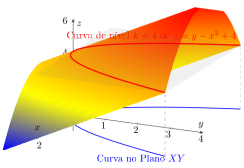
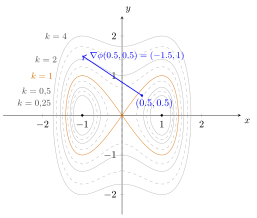

## Curvas no plano e no espaço

Antes que possamos elaborar sobre a definição e como resolver equações deste tipo, é necessário discutir algumas características das equações e das soluções para os problemas nesta disciplina.

Via de regra, nossas soluções são escritas explicitamente como uma função que depende apenas de $x$. Assim, expressões como $y=ke^{-2x}+1, k \in \mathbb{R},$ são bastante comuns. Nem sempre isto é possível, como na solução do Exemplo 01 da Aula 4, em que obtivemos a relação $\displaystyle 2\arctan\left(\dfrac{y}{x}\right)=\ln(x^2+y^2)+c, c \in \mathbb{R}.$

Reescrevendo como $\displaystyle 2\arctan\left(\dfrac{y}{x}\right)-\ln(x^2+y^2)=c, c \in \mathbb{R},$ ou seja, isolando a constante de um lado, temos uma expressão implícita equivalente a um número real qualquer. Isto pode ser interpretado como equivalente a uma curva no espaço a uma altura constante (ou nenhuma ou mais de uma curva). Assim, tomar diferentes valores para a constante equivale a tomar diferentes planos $z=c$ e, em cada um deles, obter uma curva equivalente a uma solução da EDO.

{.tikz fig-alt="Superfície z = y − x² + 4 em três dimensões, com a curva de nível k = 4 destacada em vermelho e sua projeção no plano XY em azul."}

## Outra forma de observar as equações e suas soluções

Para o desenvolvimento teórico deste conteúdo, considere que a EDO está escrita em alguma das formas $$p(x,y)dx+q(x,y)dy=0,$$ com $q(x,y) \neq 0$. Onde $q(x,y) \neq 0$, o Teorema da Função Implícita garante que a relação $\phi(x,y)=k$ define localmente uma função $y=y(x)$ derivável, que é uma solução da EDO. Nos pontos em que $q=0$ a curva de nível tem tangente vertical e não é gráfico de função de $x$; ali, se $p \neq 0$, pode-se inverter os papéis e escrever $x$ como função de $y$.

Nesta expressão, $p(x,y)$ e $q(x,y)$ representam quaisquer expressões, implícitas ou explícitas, envolvendo $x$ e $y$. Por exemplo, algo como $x^2+\sin (3xy)$.

Ao observar a equação no formato acima, é natural nos perguntarmos se ainda temos uma EDO mesmo com duas "variáveis". A resposta é sim, e o motivo é que a classificação ordinária vs. parcial diz respeito à função incógnita, nunca aos coeficientes. As funções $p$ e $q$ são, de fato, funções de duas variáveis livres: cada uma associa um ponto $(x,y)$ da região $\Omega$ a um número real. É exatamente por isso que faz sentido derivá-las parcialmente, como faremos adiante. A incógnita, porém, é $y=y(x)$, que depende de uma única variável independente.

O que a equação faz é avaliar os coeficientes ao longo do gráfico da solução, formando as composições $p(x,y(x))$ e $q(x,y(x))$. Note que a letra $y$ desempenha dois papéis: em $p(x,y)$, por exemplo, ela é apenas o nome da segunda coordenada de um ponto do plano; em $y'$, ela é a função procurada. Como só há uma variável independente, só aparecem derivadas ordinárias $y'$, e a equação permanece uma EDO de primeira ordem.

Suponha que esta EDO tem uma solução implícita na forma $\phi(x,y)=k$, em que $k \in \mathbb{R}$, ou seja, é equivalente a uma curva de nível de uma superfície em $\mathbb{R}^3$. A pergunta que fazemos é: quais condições $\phi$ precisa satisfazer para, de fato, ser uma solução desta EDO?

Como a equação envolve $y'$, precisaremos calcular $\phi'$. Neste caso, isto significa derivar com respeito a $x$. Entretanto, como a expressão de $\phi$ também tem termos contendo $y$ (e, possivelmente, não conseguiremos isolar esta função para derivar diretamente), precisaremos de derivações parciais e da regra da cadeia aprendidas em Cálculo M3 (ou N2) para obtermos alguma conclusão.

$$\dfrac{d\phi}{dx}=\dfrac{\partial \phi}{\partial x} \cdot \dfrac{dx}{dx}+\dfrac{\partial \phi}{\partial y} \cdot \dfrac{dy}{dx}=\dfrac{\partial \phi}{\partial x} +\dfrac{\partial \phi}{\partial y} \cdot \dfrac{dy}{dx}.$$

Também conseguimos analisar $\phi'$ por outro viés, relembrando que $\phi(x,y)=k$. Com esta informação, temos que $\phi'=\dfrac{d\phi}{dx}=(k)'=0$.

Agora, comparamos a expressão da EDO e as duas formas de calcular $\phi'$ que acabamos de verificar. $$p(x,y)+q(x,y)y' = 0 \qquad \qquad \dfrac{\partial \phi}{\partial x} +\dfrac{\partial \phi}{\partial y} \cdot \dfrac{dy}{dx}=0$$

Perceba que as equações são iguais caso tenhamos $p(x,y)=\dfrac{\partial \phi}{\partial x}$ e $q(x,y)=\dfrac{\partial \phi}{\partial y}$. Isto representa uma condição para que $\phi(x,y)$ seja uma solução e nos ajuda a formalizar o tipo de equação que estudaremos agora.

::: {#def-a07-1}
Sejam $p(x,y)$ e $q(x,y)$ funções de classe $C^1$ em uma região aberta $\Omega \subset\mathbb{R}^2$, ou seja, são funções cujas derivadas de primeira ordem existem e são contínuas em todos os pontos de $\Omega$.

Uma equação diferencial da forma $p(x,y)+q(x,y)y'=0$ é dita **exata** em $\Omega$ quando existe uma função $\phi(x,y)$ definida em $\Omega$ tal que $$p(x,y)=\dfrac{\partial \phi}{\partial x} \mbox{ e } q(x,y)=\dfrac{\partial \phi}{\partial y}.$$

Neste caso, as soluções são dadas implicitamente por $\phi(x,y)=k$, com $k \in \mathbb{R}$.
:::

::: {#thm-a07-1}
Nas hipóteses acima:

a)  Se a equação é exata em $\Omega$, então $$\dfrac{\partial p}{\partial y}=\dfrac{\partial q}{\partial x}$$ em todo ponto de $\Omega$.
b)  Reciprocamente, se $\Omega$ é simplesmente conexa e $$\dfrac{\partial p}{\partial y}=\dfrac{\partial q}{\partial x}$$ em todo ponto de $\Omega$, então a equação é exata.

Em particular, retângulos e discos são simplesmente conexos, o que cobre praticamente todos os exercícios desta disciplina.
:::

Por questões de simplicidade deste material, as demonstrações não serão feitas. Por outro lado, na última seção desta Aula temos uma comparação natural entre este tópico de equações diferenciais com problemas sobre campos conservativos.

Relembrando algumas das condições aprendidas em Cálculo M3 (ou N2) nos ajudam a entender um pouco melhor a condição para que a equação seja exata.

Se uma função é de classe $C^1$ em $\Omega \subset \mathbb{R}^2$, todas suas derivadas parciais de primeira ordem existem e são contínuas em todos os pontos de $\Omega$. Como $\phi$ está relacionada a $p(x,y)$ e $q(x,y)$ por derivadas, então $\phi$ é, necessariamente, uma função de classe $C^2$.

O Teorema de Schwarz-Clairaut diz que se uma função em várias variáveis $f$ está definida num aberto $\Omega \subset \mathbb{R}^2$ e se as derivadas parciais de segunda ordem forem contínuas neste intervalo, então $$\dfrac{\partial^2f}{\partial x \partial y}=\dfrac{\partial^2f}{\partial y \partial x}.$$

Portanto, para nosso problema, temos que: $$\dfrac{\partial^2\phi}{\partial y \partial x}=\dfrac{\partial^2\phi}{\partial x \partial y} \iff \dfrac{\partial}{\partial y}\left(\dfrac{\partial \phi}{\partial x}\right)= \dfrac{\partial}{\partial x}\left(\dfrac{\partial \phi}{\partial y}\right) \iff \dfrac{\partial p}{\partial y}=\dfrac{\partial q}{\partial x}.$$

Acabamos de mostrar que toda equação exata satisfaz a condição de exatidão. Na prática, porém, usamos a implicação contrária: testamos $\dfrac{\partial p}{\partial y}=\dfrac{\partial q}{\partial x}$ para decidir se a equação é exata. Essa recíproca é um resultado independente e exige que a região $\Omega$ seja simplesmente conexa. Ela é exatamente o @thm-a07-exatasimpconexa da última seção. Como trabalharemos sempre em retângulos, podemos usá-la sem receio.

Infelizmente, equações exatas não possuem uma "cara" especial como as separáveis, homogêneas, lineares ou de Bernoulli. Para termos a certeza de estarmos realmente neste tipo de equação é necessário realizar o teste com as derivadas parciais de $p(x,y)$ e $q(x,y)$ com respeito a $y$ e $x$, respectivamente.

::: {#exm-a07-1}
Resolver a equação $dx + \cos y \ dy=0$.

Neste cenário, $p(x,y)=1$ e $q(x,y)=\cos y$. Como a condição $\dfrac{\partial p}{\partial y}=\dfrac{\partial q}{\partial x}=0$ é satisfeita e as funções $p$ e $q$ são de classe $C^1$, a equação é exata.

Perceba que a função $\phi(x,y)=x+\sin y$ satisfaz a equação, já que $$p(x,y)=\dfrac{\partial \phi}{\partial x}=1 \qquad \mbox{e} \qquad q(x,y)=\dfrac{\partial \phi}{\partial y}=\cos y.$$

Portanto, as soluções desta EDO tem a forma implícita $x+\sin y = k,$ em que $k\in \mathbb{R}$.
:::

::: {#exr-a07-1}
Dentre as equações a seguir, determine quais delas são exatas.

a)  $(\sin y - y \sin x) \ dx + (\cos x + x \cos y - y) \ dy = 0$
b)  $\left( 2y - \dfrac{1}{x} + \cos 3x \right)\ \dfrac{dy}{dx} + \dfrac{y}{x^2}-4x^3+3y \sin 3x = 0$
c)  $(x+y)(x-y) \ dx + x(x-2y) \ dy = 0$
d)  $\dfrac{2x}{y} \ dx - \dfrac{x^2}{y^2} \ dy = 0$
e)  $x \dfrac{dy}{dx} = 2xe^x-y+6x^2$
:::

## Encontrando soluções da EDO exata

Uma vez que já sabemos que a equação satisfaz a condição de exatidão, o procedimento para determinar a solução é bastante simples, dependendo apenas de derivadas e integrais.

Como $p(x,y)=\dfrac{\partial \phi}{\partial x}$, então, a priori, um trecho de $\phi(x,y)$ pode ser obtido pela integral de $p(x,y)$ com respeito a $x$. Entretanto, todos os trechos que não possuem $x$ (como aqueles que só tem $y$ e constantes reais) são tratados como constantes com respeito a $x$ e foram descartados no processo de derivação. Isto nos permite escrever $$\phi(x,y)=\left( \int p(x,y) \ dx \right) + c(y).$$

Repetindo: $c(y)$ representa a constante com respeito a $x$, que pode conter trechos com $y$ e números reais (mas não pode conter $x$).

Denotando por $P(x,y)$ uma primitiva para $\displaystyle \int p(x,y) \ dx$, o próximo passo é comparar com $q(x,y)$. $$q(x,y)=\dfrac{\partial \phi}{\partial y}=\dfrac{\partial}{\partial y}\left(P(x,y)+c(y)\right)=\dfrac{\partial}{\partial y}\left(P(x,y)\right)+c'(y)$$

Se, nesta comparação, já for possível identificar qual função $c(y)$ satisfaz a condição, o problema está resolvido. Caso contrário, basta integrar $c'(y)$ para determinar uma primitiva $c(y)$.

Após identificar todas as etapas da função $\phi(x,y)$, basta completar a expressão $$\phi(x,y)=k, \mbox{ com }k \in \mathbb{R}.$$

Uma observação importante: também está correto caso desejemos começar o processo com $q(x,y)$ e, depois, usar $p(x,y)$. Porém é necessário observar que a integração passa a ser com respeito a $dy$ e a função constante depende de $x$, ou seja, tem o formato $c(x)$.

::: {#exm-a07-2}
Determinar as soluções da equação $\displaystyle (y\cos x+2xe^y) \ dx + (\sin x + x^2e^y-1)\ dy=0$.

Nesta equação, $p(x,y)=y\cos x+2xe^y$ e $q(x,y)=\sin x + x^2e^y-1$. Primeiramente, verificamos se esta EDO é exata: $$\dfrac{\partial p}{\partial y}=\cos x+2xe^y=\dfrac{\partial q}{\partial x}.$$

Sendo exata, integramos, por exemplo, $p(x,y)$ com respeito a $x$. $$\phi(x,y)=\int y\cos x+2xe^y \ dx = y \int \cos x \ dx + e^y \int 2x \ dx = y\sin x + x^2e^y + c(y).$$

Em seguida, derivamos a expressão de $\phi$ acima para determinar a função $c(y)$ ao comparar com $q$: $$q(x,y)=\begin{cases} \dfrac{\partial \phi }{\partial y} = \sin x + x^2e^y+c'(y) \\ \sin x+x^2e^y-1 \end{cases}$$ $$\implies c'(y)=-1 \implies c(y)=-y.$$

Por fim, juntamos todas as informações e incluímos a constante. As soluções desta equação diferencial exata têm a forma $$y\sin x + x^2e^y - y=k, \mbox{ sendo } k \in \mathbb{R}.$$

Se tivéssemos começado por $q(x,y)$ também teríamos o mesmo resultado. Integrando $q(x,y)$ com relação a $y$, temos $$\phi(x,y)=\int \sin x + x^2e^y - 1 \ dy = y \sin x + x^2e^y - y + c(x).$$

Derivando $\phi$ acima com relação a $x$ e comparando a $p(x,y)$, temos $$p(x,y)=\dfrac{\partial \phi }{\partial x}=y\cos x + 2xe^y+c'(x)=y\cos x + 2xe^y \implies c'(x)=0 \implies c(x)=0.$$

Juntando as informações acima à constante, determinamos as soluções desta EDO: $$y\sin x + x^2e^y - y=k, \mbox{ sendo } k \in \mathbb{R}.$$
:::

::: {.callout-note appearance="simple" icon="false"}
[Algoritmo de resolução de uma EDO exata - iniciando por $p(x,y)$]{.smallcaps}

Dada uma equação na forma $p(x,y)+q(x,y)\cdot y'=0$ em que já verificamos que é exata, seguimos os passos para determinar as soluções:

1.  Integramos $p(x,y)$ a $x$ e consideramos uma constante $c(y)$ com respeito a $x$: $$\phi(x,y)=\left( \int p(x,y) \ dx \right) + c(y).$$
2.  Derivamos a $\phi(x,y)$ acima com respeito a $y$ e comparamos com $q(x,y)$ para determinar $c(y)$.
3.  Juntamos as partes e incluímos a constante. As soluções têm a forma $$P(x,y)+c(y)=k,$$ em que $P(x,y)$ representa uma primitiva para $p(x,y)$ na integração com relação a $x$ e $k\in \mathbb{R}$ constante.
:::

::: {.callout-note appearance="simple" icon="false"}
[Algoritmo de resolução de uma EDO exata - iniciando por $q(x,y)$]{.smallcaps}

Dada uma equação na forma $p(x,y)+q(x,y)\cdot y'=0$ em que já verificamos que é exata, seguimos os passos para determinar as soluções:

1.  Integramos $q(x,y)$ a $y$ e consideramos uma constante $c(x)$ com respeito a $y$: $$\phi(x,y)=\left( \int q(x,y) \ dy \right) + c(x).$$
2.  Derivamos a $\phi(x,y)$ acima com respeito a $x$ e comparamos com $p(x,y)$ para determinar $c(x)$.
3.  Juntamos as partes e incluímos a constante. As soluções têm a forma $$Q(x,y)+c(x)=k,$$ em que $Q(x,y)$ representa uma primitiva para $q(x,y)$ na integração com relação a $y$ e $k\in \mathbb{R}$ constante.
:::

::: {#exr-a07-2}
Verifique que as equações a seguir são exatas e as resolva.

a)  $2xy \ dx + (x^2-1) \ dy=0$.
b)  $(2xy^2-3) \ dx + (2yx^2+4) \ dy=0$.
c)  $(y^3-y^2\sin x -x) \ dx + (3xy^2+2y\cos x ) \ dy =0$.
:::

::: {#exr-a07-3}
Determine a solução dos problemas de valor inicial a seguir.

a)  $(e^x+y) \ dx + (2+x+ye^y) \ dy=0$, com $y(0)=1$.
b)  $(4y+2x-5) \ dx + (6y+4x-1) \ dy=0$, satisfazendo $y(-1)=2$.
c)  $(y^2\cos x-3x^2y-2x) \ dx + (2y\sin x - x^3+\ln y) \ dy =0$, dado $y(0)=e$.
d)  $\left( \dfrac{1}{1+y^2} + \cos x -2xy \right) \ \dfrac{dy}{dx} = y(y+\sin x)$, com $y(0)=1$.
:::

::: {#exr-a07-4}
Considere uma equação diferencial separável de primeira ordem da forma $\dfrac{dy}{dx}=\dfrac{g(x)}{f(y)}$, com $f(y)\neq 0$. Mostre que esta equação também é exata.
:::

::: {#exr-a07-5}
Uma partícula desloca-se sobre o eixo $x$ de modo que o produto da velocidade pela diferença entre a posição e o tempo é igual à soma da posição com o tempo. Sabe-se que no instante $t=0$ a partícula encontra-se na posição $x=1$. Determine a posição $x=x(t)$ da partícula no instante $t>0$.
:::

## EDOs exatas e campos conservativos

Quem já cursou Cálculo M5 (ou N3), deve ter percebido alguma semelhança com os estudos sobre campos conservativos e a busca por uma função potencial.

Stewart, Clegg e Watson (2022, p. 1060), descrevem os seguintes teoremas sobre este tópico no livro Cálculo, volume 2:

::: {#thm-a07-2}
Se $\mathbf{F}(x,y)=P(x,y)\mathbf{i}+Q(x,y)\mathbf{j}$ é um campo vetorial conservativo, onde $P$ e $Q$ têm derivadas parciais de primeira ordem contínuas em um domínio $D$, então em todos os pontos de $D$ temos $$\dfrac{\partial P}{\partial y}=\dfrac{\partial Q}{\partial x}.$$
:::

::: {#thm-a07-exatasimpconexa}
Seja $\mathbf{F}=P\mathbf{i}+Q\mathbf{j}$ um campo vetorial sobre uma região $D$ aberta e simplesmente conexa[^1]. Suponha que $P$ e $Q$ tenham derivadas parciais de primeira ordem contínuas e que $$\dfrac{\partial P}{\partial y}=\dfrac{\partial Q}{\partial x}$$ por toda região $D$. Então $\mathbf{F}$ é conservativo.
:::

No início do material desta aula, analisamos que as curvas no plano $XY$ soluções da EDO equivalem a curvas de nível de uma superfície no espaço tridimensional.

Na nossa disciplina, podemos considerar que as funções $p(x,y)$ e $q(x,y)$ associam, cada uma delas, pontos do plano cartesiano a um número real. Pensando as duas em conjunto, temos uma função vetorial! $$F(x,y)=(p(x,y), q(x,y))$$

Se retormarmos Cálculo M5 (ou N3), um campo é conservativo quando existe uma função $\phi$, chamada de função potencial, tal que $$\mathbf{F}=\nabla \phi=\left(\dfrac{\partial \phi}{\partial x}, \dfrac{\partial \phi}{\partial y}\right).$$ Como é conservativo, a variação de $\phi$ entre dois pontos depende apenas dos pontos inicial e final, e não do caminho percorrido entre eles. Em particular, ao percorrer qualquer circuito fechado voltamos à mesma altitude, e o trabalho total realizado pelo campo é nulo. É daí que vem o nome "conservativo".

Uma ótima analogia é a de mapas topográficos representando as curvas de nível. Apesar de não representar no espaço tridimensional a inclinação em cada um dos pontos, conseguimos interpretar que as regiões mais íngremes são aquelas em que as linhas estão mais próximas e as mais suaves são as em que as linhas estão mais espaçadas. Além disso, a subida mais rápida acontece quando cruzamos estas linhas perpendicularmente. O mapa das altitudes é a função potencial e o emaranhado de setas indicando as subidas é o campo vetorial.

{.tikz fig-alt="Curvas de nível de uma função potencial φ, com k = 0,25; 0,5; 1; 2 e 4, e o vetor gradiente ∇φ desenhado a partir do ponto (0,5; 0,5)."}

Em EDO, a equação $p(x,y) \ dx + q(x,y) \ dy =0$ pode ser interpretada em termos de vetores: $$p(x,y) \ dx + q(x,y) \ dy =0 \iff (p,q) \cdot (dx, dy) =0$$ A igualdade da direita nos diz que o produto escalar entre o vetor $(p,q)$, equivalente ao campo vetorial $F$, e o vetor $(dx, dy)$, equivalente ao vetor tangente ao gráfico da solução, é nulo e, consequentemente, os vetores são perpendiculares[^2].

Assim, uma interpretação geométrica da equação das EDOs exatas, é que as soluções são curvas que caminham perpendicularmente ao campo vetorial definido por $(p(x,y),q(x,y))$. Mas como o gradiente $\nabla \phi = \left(\dfrac{\partial \phi}{\partial x}, \dfrac{\partial \phi}{\partial y}\right)$ é perpendicular às curvas de nível em um campo conservativo, então, juntando as informações, temos que o gráfico de cada solução da EDO está contido num conjunto de nível de $\phi$; e, reciprocamente, em torno de um ponto do nível onde $q=\dfrac{\partial \phi}{\partial y}\neq 0$, o conjunto de nível é o gráfico de uma solução $\phi=y(x)$.

[^1]: Ou seja, é uma região em que toda curva fechada simples em $D$ possui apenas pontos de $D$. Com isto, essa região não contém nenhum buraco e não consiste em regiões separadas.

[^2]: Lembre que, em Geometria analítica, dois vetores $\vec{v_1}$ e $\vec{v_2}$ são ortogonais se e somente se $\vec{v_1}\cdot \vec{v_2}=0$
