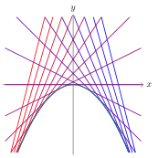
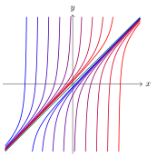
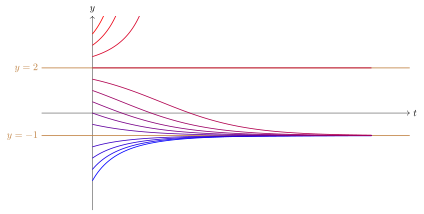

::: {#def-a09-1}
Uma equação diferencial ordinária de primeira ordem é dita **de Clairaut** se é da forma $$y=xy'+g(y'),$$ em que $g(y')$ é uma função real qualquer sobre a derivada de $y$.
:::

::: {#exm-a09-1}
As equações $y=xy'+(y')^2$ e $y=xy'+\sin(y')+\cos(y')$ são equações de Clairaut.
:::

Perceba que este tipo de equação não se inicia com a derivada isolada do lado esquerdo. No lugar dela, está $y$. Do lado direito a expressão depende de $xy'$ e de uma função de $y'$, denotada por $g(y')$.

Para determinar as soluções deste tipo de EDO, começamos derivando ambos os termos da equação (utilizando as regras do produto e regra da cadeia): $$y=xy'+g(y') \implies y'=(xy')'+(g(y'))' \implies \cancel{y'}= \cancel{y'}+xy''+g'(y')\cdot y''$$ $$\implies y''(x+g'(y'))=0.$$

O produto acima apenas é nulo se algum dos fatores for nulo. Assim, estudamos os casos $y''=0$ e $x+g'(y')=0$.

***Caso 1:*** $y''=0$

Neste cenário, a segunda derivada é nula. Isto significa que a função $y'=t$ para algum parâmetro real $t$. Se integrarmos novamente, obtemos $y=tx+d,$ em que $d$ também é uma constante real.

Se substituirmos na equação de Clairaut, temos que:

$$y=xy'+g(y') \implies (tx+d) = x\cdot (t) + g(t) \implies d=g(t).$$

Assim, a solução geral desta EDO é uma família de retas da forma $y=tx+g(t),$ sendo $t$ um parâmetro real.

***Caso 2:*** $x+g'(y')=0$

Neste cenário, não é possível determinar um procedimento único para todas as EDOs. Por outro lado, existe uma técnica de determinar soluções paramétricas a partir da substituição $t=y'$. Isolando $x$ na expressão e substituindo na equação de Clairaut, temos as condições:

$$x=-g'(t) \implies y=-g'(t)\cdot t+g(t), \qquad \mbox{isto é, } \qquad \begin{cases} x=-g'(t) \\ y=-g'(t)\cdot t+g(t)\end{cases}$$ é a solução dependente do parâmetro $t=y'$.

::: {#exm-a09-2}
No início desta seção, tivemos a equação de Clairaut $y=xy'+(y')^2$.

Derivando ambos os lados, obtemos $$y'=y'+xy''+(2y')y'' \implies y''(x+2y')=0.$$

A solução geral é dada pela resolução de $$\begin{cases} y=xy'+(y')^2 \\ y''=0 \end{cases} \implies \begin{cases} y=xy'+(y')^2 \\ y=tx+d \end{cases} \implies y=tx+t^2,$$ em que $t \in \mathbb{R}$ é um número real qualquer (para cada valor de $t$, temos uma reta diferente). A solução singular é dada por

$$\begin{cases} x+2y'=0 \\ y=xy'+(y')^2 \end{cases} \implies \begin{cases} x=-2y' \\ y=(-2y')t+(y')^2 \end{cases} \implies \begin{cases} x=-2t \\ y=(-2t)t+(t)^2 \end{cases}$$ $$\implies  \begin{cases} t=-\dfrac{x}{2} \\ y=-t^2 \end{cases} \implies y=-\left(-\dfrac{x}{2}\right)^2=-\dfrac{x^2}{4}.$$

{.tikz fig-alt="Família de retas y = tx + t², soluções gerais da equação de Clairaut, todas tangentes à parábola y = −x²/4, que é a solução singular."}

Na figura acima, as retas pertencem à família de soluções gerais e a parábola é a solução singular.
:::

Ao observarmos bem o comportamento da solução do exemplo anterior, podemos notar que a solução geral (as retas) sempre tangenciam a solução singular (a parábola). Por que isto acontece? E acontece sempre? A resposta é sim, mas desde que $g''(t) \neq 0$, ou seja, desde que $g$ não seja uma função afim.

Em Geometria Diferencial, o conceito de **envoltória** (ou envelope) descreve exatamente este cenário: a envoltória de uma família de curvas $\mathcal{C}=\{\mathcal{C}_t\}$ é uma nova curva $\mathcal{E}$ tal que, para cada valor do parâmetro $t$, existe um ponto $P_0=(x_0,y_0)$ de $\mathcal{E}$, mp qual $\mathcal{E}$ é tangente à curva $\mathcal{C}_t$. Assim, há uma correspondência entre cada valor de $t$ a uma curva da família.

Se tomarmos a solução geral da equação de Clairaut $y=tx+g(t)$ e derivá-la com respeito a $t$, temos $$0=x+g'(t) \implies x=-g'(t) \implies \begin{cases} x=-g'(t) \\ y=-g'(t)\cdot t+g(t)\end{cases} \implies \dfrac{dy}{dx}=\dfrac{dy/dt}{dx/dt}=\dfrac{-g''(t)\cdot t}{-g''(t)}=t$$ justamente a solução singular. Por isto, a nova curva herda a inclinação $t$ para cada um dos pontos de seu domínio, desde que $g''(t) \neq 0$.

::: {#exr-a09-1}
Resolva cada uma das equações de Clairaut dadas abaixo, indicando as soluções geral e singular.

a)  $\displaystyle y=xy'+1-\ln y'$
b)  $y = x\dfrac{dy}{dx}-\left(\dfrac{dy}{dx}\right)^3$
c)  $xy'-y=e^{y'}$
d)  $y=(x+4)y'+(y')^2$
:::

::: {#exr-a09-2}
Verifique que $\displaystyle y'=(xy'-y)\sqrt{1+(y')^2}$ é uma equação de Clairaut. Em seguida, determine uma família de soluções satisfazendo $x>0$ e $y'<0$.
:::

::: {#exr-a09-3}
A equação $y=xy'+\sin(y')+\cos(y')$, presente no Exemplo 01, também admite solução. O objetivo desta questão é identificar e analisar o comportamento da envoltória. Para isto,

a)  Resolva a equação, determinando a solução geral e a solução singular paramétrica

    $\begin{cases} x=\sin t + \cos t \\ y=(\sin t -\cos t)t+(\sin t+\cos t)\end{cases}$

b)  Em seguida, utilize a relação trigonométrica fundamental para expressar $g(t)=\sin t + \cos t$ em termos de $x=\sin t - \cos t$. Avalie as condições para a validade desta igualdade.

c)  Partindo da igualdade $x=\sin t - \cos t$, multiplique-a por $\dfrac{\sqrt{2}}{2}$ e utilize a relação do seno da soma $\sin(a+b)=\sin a \cos b + \sin b \cos a$ para isolar $t$ na expressão de $x$. Avalie as condições para a validade desta igualdade.

d)  Conclua que uma expressão explícita para a função envelope é $y=\arcsin\left(\dfrac{x\sqrt{2}}{2}\right)+\dfrac{\pi}{4}$, com $-\sqrt{2}\leq x \leq \sqrt{2}$.
:::

## Equação de Ricatti

::: {#def-a09-2}
Uma EDO de primeira ordem é dita **de Ricatti** se é da forma $$y'=f(x)+g(x)y+h(x)y^2,$$ em que $f(x), g(x)$ e $h(x)$ são funções reais em $x$.
:::

::: {#exm-a09-3}
São equações de Ricatti:

- $y'=1+x^2-2xy+y^2$
- $y'=\sin x+(\tan x) y^2$
- $y'=(\ln x)y - y^2$
:::

Infelizmente, este tipo de equação não possui um procedimento geral para determinar todas as suas soluções. Entretanto, caso conheçamos pelo menos uma solução particular $\phi_1(x)$, podemos determinar todas as outras.

Para encontrar todas as soluções a partir de $\phi_1,$ utilizamos a substituição $y(x)=\phi_1(x)+\dfrac{1}{w(x)},$ em que $w$ representa a nova função a ser analisada. Ao derivarmos esta expressão e substituindo na equação de Ricatti, obtemos $$y(x)=\phi_1(x)+\dfrac{1}{w(x)} \qquad \implies \qquad y'(x)=\phi_1'(x)-\dfrac{w'(x)}{w^2(x)}$$ $$y'=f(x)+g(x)y+h(x)y^2$$ $$\implies \left(\phi_1'(x)-\dfrac{w'(x)}{w^2(x)}\right)=f(x)+g(x)\left(\phi_1(x)+\dfrac{1}{w(x)}\right)+h(x)\cdot\left(\phi_1(x)+\dfrac{1}{w(x)}\right)^2$$ $$\implies \cancel{\phi_1'(x)}-\dfrac{w'(x)}{w^2(x)}=\cancel{f(x)}+\cancel{g(x)\phi_1(x)}+\dfrac{g(x)}{w(x)}+\cancel{h(x)\phi_1^2(x)}+\dfrac{2\phi_1(x)h(x)}{w(x)}+\dfrac{h(x)}{w^2(x)}$$

Na expressão acima, os termos cancelados são consequência de $\phi_1$ ser uma solução da equação diferencial de Ricatti, ou seja, $\phi_1$ é tal que $\phi_1'(x)=f(x)+g(x)\phi_1(x)+h(x)\phi_1^2(x)$.

Organizando os termos restantes, temos $$-\dfrac{w'(x)}{w^2(x)} = \dfrac{g(x)}{w(x)}+\dfrac{2\phi_1(x)h(x)}{w(x)}+\dfrac{h(x)}{w^2(x)} \implies w'(x) = -g(x)w(x)-2\phi_1(x)h(x)w(x)-h(x)$$ $$w'(x) = \Big(-g(x)-2\phi_1(x)h(x)\Big)w(x)-h(x).$$

Observe que a equação acima representa uma EDO linear em $w(x)$. Agora podemos resolver o problema e encontrar as soluções em $w$ e, depois, retornar a solução geral $\phi(x)$ através da substituição inicial $\phi(x)=\phi_1(x)+\dfrac{1}{w(x)}$.

::: {#exm-a09-4}
No início desta seção, tivemos a equação de Ricatti $y'=1+x^2-2xy+y^2$.

Com alguma atenção, é possível perceber que $\phi(x)=x$ é uma solução desta equação. Ao aplicarmos a substituição $y=x+\dfrac{1}{w} \implies y'=1-\dfrac{w'}{w^2}$, temos

$$y'=1+x^2-2xy+y^2 \implies 1-\dfrac{w'}{w^2}=1+x^2-2x\cdot \left(x+\dfrac{1}{w}\right)+\left(x+\dfrac{1}{w}\right)^2$$ $$\implies \cancel{1}-\dfrac{w'}{w^2}=\cancel{1}+\cancel{x^2}-\cancel{2x^2}-\cancel{\dfrac{2x}{w}}+\cancel{x^2}+\cancel{\dfrac{2x}{w}}+\dfrac{1}{w^2} \implies w'=-1 \implies w=-x+c,$$ em que $c$ é uma constante real.

Portanto, a solução geral desta EDO tem o formato $\displaystyle \phi(x)=x+\dfrac{1}{c-x},$ sendo $c$ uma constante real.

{.tikz fig-alt="Gráficos de várias soluções da forma φ(x) = x + 1/(c − x), cada uma com uma assíntota vertical em x = c."}

A solução particular $y=x$ é tangente a todas as curvas da solução geral $\phi(x)=x+\dfrac{1}{c-x}$.
:::

Na ilustração gráfica do exemplo anterior, novamente as assíntotas são peça chave na compreensão do comportamento das soluções: parece que a solução geral sempre é assintótica à solução particular dada quando $x$ tende a infinito. Isto acontece sempre?

A resposta é não. Depende de quem é a solução particular. A chave para entendermos este cenário depende da expressão que relaciona a solução geral e a particular $\displaystyle \phi(x)=\phi_1(x)+\dfrac{1}{w(x)}$. Se $\displaystyle \lim_{x \to \infty} \dfrac{1}{w(x)}=0$, então, no infinito, tem-se $\phi(x)$ e $\phi_1(x)$ tornam-se arbitrariamente próximas, ou seja, a solução geral assintota a particular. Caso o limite não seja nulo, então não ocorre tal assíntota.

A justificativa de quando este comportamento acontece depende diretamente de entendermos o processo de determinarmos $w(x)$. Ao escolhermos (ou tomarmos) uma solução particular, a mudança de variável necessária determina a função $w(x)$ a ser encontrada. Ao aplicar tal mudança de variável, obtemos a EDO linear $w'(x) = \Big(-g(x)-2\phi_1(x)h(x)\Big)w(x)-h(x)$. Se escrevermos $p(x)= -g(x)-2\phi_1(x)h(x)$ e $q(x)=-h(x)$, a equação se reduz a $$w'(x)=p(x)w(x)+q(x),$$ que admite como solução $$w(x)=e^{P(x)}\left(\int \dfrac{q(x)}{e^{P(x)}}\ dx + c\right),$$ em que $P(x)$ é uma primitiva para $p(x)$ e $c$ é uma constante real qualquer.

É o comportamento dos dois fatores $e^{P(x)}$ e $\int \dfrac{q(x)}{e^{P(x)}}\ dx + c$ quando $x$ cresce indefinidamente que define se existe um comportamento assintótico.

Estas soluções podem ser classificadas como **estáveis** ou **instáveis**. Quando forem estáveis, acontece como no exemplo que vimos: a solução geral sempre se aproxima desta solução particular estável no infinito. Por outro lado, soluções instáveis "afastam" a solução geral.

::: {#exm-a09-5}
A equação de Ricatti $y'=-2-y+y^2$ admite as soluções constantes $y=-1$ e $y=2$. A solução geral desta equação pode ser expressa como $$y=2+\dfrac{3}{ce^{-3x}-1}.$$

Ao tomarmos o limite quando $x$ tende ao infinito, temos que $$\lim_{x \to -\infty} 2+\dfrac{3}{ce^{-3x}-1}=2 \qquad \mbox{ e } \lim_{x \to +\infty} 2+\dfrac{3}{ce^{-3x}-1}=-1.$$

Isto quer dizer que todas as infinitas soluções partem de próximo da solução constante $y=2$ mas sempre se afastam dela, ou seja, esta é uma solução instável; por outro lado, todas as soluções não constantes se aproximam de $y=-1$ quando $x$ cresce indefinidamente, ou seja, $y=-1$ é uma solução estável.

{.tikz fig-alt="Soluções da equação: as que começam perto da reta y = 2 se afastam dela, e todas as não constantes se aproximam da reta y = −1."}
:::

O tipo de análise que acabamos de fazer é parte fundamental do estudo das equações autônomas, tema da nossa próxima aula.

::: {#exr-a09-4}
Resolva cada uma das equações de Ricatti dadas abaixo, considerando a solução conhecida indicada.

a)  $y'=y^2-y-2$, dada $\phi_1(x)=2$.
b)  $y'=xy^2-x-y+1$, considerando $\phi_1(x)=1$.
c)  $\dfrac{dy}{dx}=-\dfrac{4}{x^2}-\dfrac{1}{x}y+y^2$, sendo $\phi_1(x)=\dfrac{2}{x}$.
d)  $y'=\sec^2 x - (\tan x)y+y^2$, dada $\phi_1(x)=\tan x$.
:::
