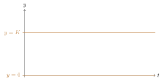
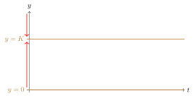
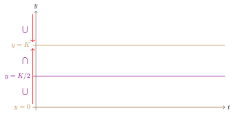
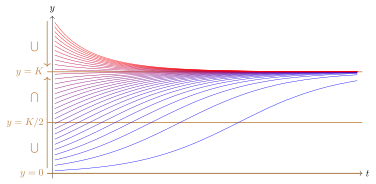

::: {#def-a10-1}
Uma EDO é dita **autônoma** se pode ser escrita como $y'=f(y)$, ou seja, se sua derivada equivale a uma expressão que não depende da variável independente $x$.
:::

::: {#exm-a10-1}
- $y'=\sin y + y^2\cos y$ é uma EDO autônoma, pois não depende de $x$.
- $y'=x\sin y$ não é uma EDO autônoma, embora seja separável.
:::

Nesta etapa do nosso estudo, estaremos preocupados em resolver estas EDOs utilizando as ferramentas já conhecidas, mas também de interpretar o que as soluções e métodos empregados significam.

## Crescimento populacional

Uma aplicação simples das equações autônomas de primeira ordem estão associadas a análise do comportamento de uma população.

Seja $y=P(t)$ a população de uma espécie dada no instante $t$. A hipótese mais simples[^1] é que a taxa de variação desta população é proporcional ao valor atual de $y$. Logo, podemos escrever $$\dfrac{dy}{dt}=ry,$$ em que $r$ é uma constante.

Quando que esta população está crescendo e quando ela está decrescendo?

Lembrando de Cálculo M1 (ou N1), se $f'(x)$ for um número positivo, então $f$ é crescente; se $f'$ for negativa, então $f$ é decrescente. Usamos isto para dizer que:

- Se $r$ for uma constante positiva, então a população $y$ cresce;
- se a constante $r$ for negativa, então a população decresce.

Caso saibamos a população inicial (ou seja, se tomarmos $y(0)=y_0$), resolvemos este problema de valor inicial: $$\dfrac{dy}{dt}=ry \implies \dfrac{dy}{y}=r \ dt \implies \ln|y|=rt+c \implies y=ke^{rt},$$ em que $k$ é uma constante real não nula. Para determinar $k$, substituímos o ponto $(0, y_0)$: $$y_0=ke^0 \implies k=y_0.$$ Com isto, a equação que modela nosso problema é da forma $$y=y_0e^{rt}.$$

Perceba que esta equação, por ser separável, admitia solução constante $y=0$. Entretanto, esta solução não tinha significado real, uma vez que estudar o comportamento de uma população nula não faz sentido.

## Equação logística

E se a constante $r$ for substituída por uma função dependente de $y$, ou seja, o que muda para o estudo da equação $y'=h(y)\cdot y$?

Primeiramente, as soluções constantes para este problema são $y=0$ e todas as retas horizontais da forma $y=\alpha$, em que $\alpha$ é uma solução de $h(y)=0$.

Para desenvolver os procedimentos do que chamaremos de equação logística, utilizamos uma função simples tal que,

- quando $y$ for pequeno, $h(y)$ se comporte aproximadamente como $r>0$.
- quando $y$ for suficientemente grande, $h(y)$ seja um número negativo.

A função mais simples que satisfaz estas condições é $h(y)=r-ay$, em que $a$ é uma constante positiva.

::: {#def-a10-2}
Uma equação da forma $$y'=(r-ay)y \qquad \qquad \mbox{ou} \qquad \qquad  y'=r\left(1-\dfrac{y}{K}\right)y,$$ em que $r$ e $a$ são constantes positivas e $K=\dfrac{r}{a}$, é chamada de **equação logística** ou equação de Verhulst.
:::

Estas equações representam, geralmente, modelos de crescimento populacional mais precisos que aquele visto na seção anterior, principalmente quando consideramos populações muito grandes, como a de regiões inteiras ou países. Zill & Cullen (2007, p. 119) descrevem a utilização do modelo logístico:

> Curvas logísticas são modelos bem acurados para previsão de crescimento populacional, em um espaço limitado, de certos tipos de bactérias, protozoários, pulgas d'água (*Daphnia*) e moscas da fruta (*Drosophila*).

Os autores citam, também, que a equação $\dfrac{dx}{dt}=kx(n+1-x),$ com $k >0$, apresenta uma modelo para a "disseminação de uma epidemia trazida inicialmente pela introdução de um indivíduo infectado em uma população estática", assim como para a propagação de informações e o impacto de anúncios em determinadas regiões. Ao compararmos à primeira forma da escrita de uma equação logística, percebemos que esta é um caso especial tal que $r=k(n+1)$ e $a=k$.

### As soluções constantes

Além da solução $y=0$, verificamos quando $1-\dfrac{y}{K}=0$, ou seja, $y=K$. Estas soluções são soluções de equilíbrio e a população não se altera com o passar do tempo.

Independentemente de qual seja o valor de $K$ (que é sempre positivo), o gráfico que sintetiza todas as soluções tem estas retas presentes.[^2]

{.tikz fig-alt="Plano ty com as duas soluções de equilíbrio da equação logística: as retas horizontais y = 0 e y = K."}

### O crescimento/decrescimento das soluções não constantes

Do estudo sobre derivação, sabemos que a função é crescente (respectivamente, decrescente) quando sua derivada é positiva (respectivamente, negativa). Por mais que não tenhamos mais informações sobre $x$, podemos fazer a análise a partir do $y'$ da equação e dos possíveis valores para $y$.

$$y'=r\left(1-\dfrac{y}{K}\right)y$$

Na expressão acima, $r$ representa uma constante positiva. Assim, o sinal da derivada é positivo quando $1-\dfrac{y}{K}$ e $y$ têm sinais iguais e sinal negativo quando têm sinais distintos.

{.tikz fig-alt="Estudo de sinal para y > 0: entre 0 e K, os fatores 1 − y/K e y são positivos e y′ é positiva; acima de K, 1 − y/K e y′ são negativos."}

Com isto, concluímos que esta função decresce quando $y<0$ ou quando $y>K$ e cresce quando $0 < y < K$.

Ao registrar esta informação ao lado das informações que temos sobre o gráfico, é importante lembrar que estas informações sobre crescimento e decrescimento são relativas à reta vertical, já que esta análise foi feita a partir do estudo dos sinais de $y$. Com isto, adicionamos a esta informação ao gráfico anterior, aqui registradas em vermelho ao lado do eixo $y$. É bastante comum chamar o eixo vertical, juntamente com a indicação do crescimento e decrescimento, de **reta de fase**.

{.tikz fig-alt="Retas y = 0 e y = K com setas ao lado do eixo y: entre 0 e K as soluções crescem; acima de K, decrescem."}

### A concavidade dos gráficos das soluções não constantes

Do estudo sobre derivação, sabemos que a função é convexa (respectivamente, côncava) quando sua segunda derivada é positiva (respectivamente, negativa). Utilizamos a regra da cadeia na expressão anterior para fazermos o estudo de sinais.

$$y''=(y')'=r\left(y-\dfrac{y^2}{K}\right)'=r\left(y'-\dfrac{2yy'}{K}\right)=r\left(1-\dfrac{2y}{K}\right)y'$$

Assim como na etapa anterior, $r>0$ e o sinal da segunda derivada depende de um produto. Nesta etapa, os fatores são a expressão em parênteses e $y'$.

{.tikz fig-alt="Estudo de sinal com os pontos K/2 e K: y″ é positiva entre 0 e K/2, negativa entre K/2 e K e positiva acima de K."}

Assim, a concavidade está para cima quando $0<y<K/2$ ou quando $y>K$ e está para baixo quando $K/2<y<K$. Adicionamos esta informação próximo à reta de fase para organizarmos as informações já obtidas.

{.tikz fig-alt="Retas y = 0, y = K/2 e y = K com setas de crescimento e símbolos de concavidade: para cima entre 0 e K/2, para baixo entre K/2 e K, para cima acima de K."}

### As informações obtidas nos fornecem dados sobre os gráficos

É necessário articular os conhecimentos sobre os intervalos de crescimento e decrescimento das funções aos sobre os intervalos de concavidades dos gráficos.

Para isto, relembramos Cálculo M1 (ou N1) e os estudos sobre o gráfico de uma função. A depender de cada uma das quatro configurações possíveis de sinal de $y'$ e $y''$ (desconsiderando os casos em que alguma delas se anula), podem aparecer os seguintes tipos de arcos:

{.tikz fig-alt="Os quatro tipos de arco conforme os sinais de f′ e f″: decrescente e côncavo para baixo, crescente e côncavo para baixo, decrescente e côncavo para cima, crescente e côncavo para cima."}

Também precisamos observar que não temos a informação sobre a partir de que momento em $t$ a função passa a ser crescente ou decrescente ou passa a ser côncava ou convexa: tudo que sabemos depende exclusivamente de $y$!

- Qualquer gráfico de uma solução muda de comportamento de crescimento nas retas $y=0$ e $y=K$, dado o estudo da primeira derivada;
- Qualquer gráfico de uma solução muda de comportamento das concavidades quando cruza a reta $y=\dfrac{K}{2}$, dado o estudo da segunda derivada.

Com estas condições, conseguirmos plotar os gráficos das soluções da EDO, constantes e não constantes, a partir da análise acima, dependendo apenas de qual é o ponto $y(0)=y_0$ dado.

{.tikz fig-alt="Várias soluções da equação logística: todas as não constantes se aproximam da reta y = K, e as que começam abaixo de K/2 mudam de concavidade ao cruzar essa reta."}

Analisando globalmente a imagem, considerando as soluções constantes, não constantes, crescimento e concavidades, alguns padrões interessantes aparecem:

- Todos os gráficos que começam abaixo de $K$ se aproximam, eventualmente, da reta $y=K$ mas nunca a ultrapassam;
- Todos os gráficos que começam acima de $K$ se aproximam, eventualmente, de $y=K$ e também nunca a ultrapassam;
- As soluções não-constantes tendem à solução constante $y=K$ assintoticamente quando $t$ cresce indefinidamente;
- A solução constante $y=0$ não é aproximação de nenhuma das soluções não-constantes.

Estas observações nos permitem novas definições sobre o comportamento geral das soluções da equação logística.

- O fato das soluções não-constantes tenderem a $K$ mas nunca ultrapassarem $y=K$ nos permite inferir que $K$ é o **nível de saturação** ou **capacidade ambiental de sustentação** para a espécie dada por este modelo;
- As soluções não constantes se aproximarem da solução constante $y=K$ nos permite apontar que esta é uma **solução assintoticamente estável** da EDO;
- O fato de mesmo as soluções que começam bem próximas de $y=0$ crescerem quando $t$ cresce nos permite indicar que esta solução constante é uma **solução de equilíbrio instável**.

::: {#exr-a10-1}
Esboce o gráfico de $f(y)$ em função de $y$, determinando os pontos críticos (de equilíbrio) e classificando cada um deles como assintoticamente estável, instável ou semi-estável. Esboce diversos gráficos das soluções no plano $XY$.

a)  $y'=ay+by^2$, sendo $a, b>0$ e $y_0\geq 0$.
b)  $y'=y^2(y^2-1)$, com $y_0 \in \mathbb{R}$.
c)  $y'=ay+by^2$, sendo $a, b>0$ e $y_0 \in \mathbb{R}$.
d)  $y'=2y-\sqrt{y}$, dado $y_0\geq 0$.
e)  $y'=e^y-1$, com $y_0 \in \mathbb{R}$.
f)  $y'=e^{-y}-1$, com $y_0 \in \mathbb{R}$.
g)  $y'=\dfrac{-2\arctan y}{1+y^2}$, $y_0 \in \mathbb{R}$.
:::

::: {#exr-a10-2}
Uma equação diferencial que descreve um modelo de crescimento com restrição é da forma $$\dfrac{dy}{dt}=ky(L-y),$$ em que $y$ em que $k$ representa uma constante positiva de proporcionalidade e $L$ representa um limiar de crescimento.

a)  Mostre que a solução geral deste problema tem a forma $\displaystyle y(t)=\dfrac{L}{1+ce^{-kLt}},$ em que $c$ é uma constante real não nula.
b)  Mostre que a taxa de crescimento de $y$ é máxima em $\displaystyle t=\dfrac{\ln |c|}{kL}$.
:::

::: {#exr-a10-3}
Outro modelo para o crescimento populacional derivado da equação logística considera uma retirada constante da população. Por exemplo, modela sistemas em que peixes são coletados a uma taxa constante $c$. A equação geral que modela este problema tem a forma $\displaystyle \dfrac{dP}{dt}=kP\left(1-\dfrac{P}{K}\right)-c.$

Certa população de peixes é modelada por $\displaystyle \dfrac{dP}{dt}=0,08P\left(1-\dfrac{P}{1000}\right)-15.$

Analise o comportamento desta população.

a)  Qual o significado do número $-15$?
b)  Quais são as soluções de equilíbrio?
c)  Para quais valores iniciais a população cresce e para quais ela decresce?
d)  Para quais valores iniciais a taxa de crescimento da população aumenta ou diminui?
e)  Determine quando a população tende a estabilizar (sobrevivendo ou extinguindo).
f)  Resolva a equação e determine explicitamente a solução.
:::

::: {#exr-a10-4}
Existe evidência considerável para apoiar a teoria de que, para algumas espécies, existe uma população mínima $m$ de forma que as espécies se tornam extintas quando o tamanho da população cai abaixo de $m$. Um modelo desta forma altera a equação logística para $$\displaystyle \dfrac{dP}{dt}=kP\left(1-\dfrac{P}{K}\right)\left(1-\dfrac{m}{P}\right).$$

a)  Quais são as soluções de equilíbrio?
b)  Para quais valores iniciais a população cresce e para quais ela decresce?
c)  Para quais valores iniciais a taxa de crescimento da população aumenta ou diminui?
d)  Determine quando a população tende a estabilizar (sobrevivendo ou extinguindo).
e)  Resolva a equação e determine explicitamente a solução.
:::

::: {#exr-a10-5}
A equação de Gompertz, também usada para modelar o crescimento populacional, é dada por $$\dfrac{dy}{dt}=ry\ln(K/y),$$ em que $r$ e $K$ são constantes positivas.

a)  Quais são as soluções de equilíbrio?
b)  Para quais valores iniciais a população cresce e para quais ela decresce? As soluções de equilíbrio são estáveis, instáveis ou semi-estáveis?
c)  Para quais valores iniciais a taxa de crescimento da população aumenta ou diminui?
d)  Para cada $0\leq y \leq K$, mostre que $y'$ dado pela equação de Gompertz nunca é menor do que $y'$ dado pela equação logística.
e)  Resolva a equação de Gompertz, usando $y(0)=y_0$ e a substituição $u=\ln(y/K)$.
:::

[^1]: Porque esta população pode depender de outros fatores não considerados nesta formulação como, por exemplo, migrações internas e externas, ou eventos pontuais, como guerras.

[^2]: Lembre-se que, neste modelo, $y$ representa uma população, sempre um valor não-negativo. O mesmo ocorre com a variável independente $t$, já que o tempo de análise do sistema com indicação do início da medição é também um valor não negativo.
