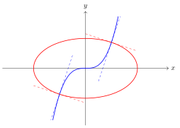
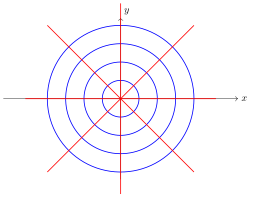

Alguns campos do conhecimento dão origem a problemas que podem ser modelados por equações diferenciais ordinárias de primeira ordem. Nesta seção, estudaremos como as EDOs aparecem dentro de cinco temas:

- Trajetórias ortogonais
- Juros compostos
- Meia-vida
- Lei de resfriamento de Newton
- Misturas

O objetivo desta seção não será resolver completamente e exaustivamente exercícios ou de nos aprofundarmos nos modelos matemáticos, mas sim na construção das equações, que recaem sempre em problemas que vocês já são capazes de resolver.

## Trajetórias ortogonais

No estudo da Geometria Analítica Plana, as características das retas coincidentes, paralelas, concorrentes e perpendiculares se dá a partir da análise dos coeficientes de $ax+by=c$.

O breve estudo a seguir traz os mesmos elementos para o caso das curvas. Tal análise é aplicada, principalmente, no estudo de Eletromagnetismo, Termodinâmica, Aerodinâmica e Meteorologia, por exemplo.

::: {#def-a12-1}
Duas curvas $\mathcal{C}_1$ e $\mathcal{C}_2$ são ditas **ortogonais** se, nos pontos em que se intersectam, as retas tangentes a elas são perpendiculares.
:::

Lembremos que duas retas $r_1: m_1x+n_1$ e $r_2:m_2x+n_2$ são perpendiculares no plano se e somente suas inclinações satisfazem $$m_1=-\dfrac{1}{m_2}.$$

::: {#exm-a12-1}
Para mostrar que as curvas $\mathcal{C}_1: y=x^3$ e $\mathcal{C}_2: x^2+3y^2=4$ são ortogonais, primeiramente observamos os pontos de interseção para, posteriormente, avaliar a condição de perpendicularidade das tangentes:

$$x^2+3(x^3)^2=4 \implies x^2+3(x^2)^3=4 \iff 3t^3+t=4 \implies t=1 \mbox{ ou } 3t^2+3t+4=0.$$

Como a única solução real é $t=1$, então $x=1$ ou $x=-1$. Logo, os pontos de interseção são $(1,1)$ e $(-1,-1)$.

Para determinar as retas tangentes às curvas, precisamos das derivadas de ambas:

$$y'=3x^2 \implies y'(1)=y'(-1)=3$$ $$2x+6y\cdot y'=0 \implies y'=-\dfrac{x}{3y} \implies y'(1)=y'(-1)=-\dfrac{1}{3}.$$

{.tikz fig-alt="Curva y = x³ (azul) e elipse x² + 3y² = 4 (vermelha), que se cruzam em (1, 1) e (−1, −1); as retas tangentes às duas curvas nesses pontos são perpendiculares."}
:::

O conceito é facilmente estendível a famílias de curvas.

::: {#def-a12-2}
Duas famílias de curvas $\mathcal{F}_1$ e $\mathcal{F}_2$ são **trajetórias ortogonais** uma da outra se todas as curvas de uma família interceptam ortogonalmente todas as curvas da outra.
:::

Perceba que nesta definição, podemos tomar qualquer curva de cada uma das famílias e, necessariamente, estas duas curvas são ortogonais entre si.

::: {#exm-a12-2}
A família de retas $\mathcal{F}_1=\{(y=c_1x)\cup(x=0); c_1 \in \mathbb{R}\}$ e a família de círculos $\mathcal{F}_2=\{x^2+y^2=c_2; c_2 \in \mathbb{R}^*_+\}$ são trajetórias ortogonais uma da outra.

{.tikz fig-alt="Retas que passam pela origem (vermelhas) e círculos centrados na origem (azuis): cada reta corta cada círculo em ângulo reto."}
:::

Para determinar a trajetória ortogonal a uma família de curvas, seguimos o mesmo procedimento de antes, relacionando as condições das inclinações das retas tangentes, ou seja, comparando as derivadas.

Em especial, se uma família de curvas $\mathcal{F}_1$ é tal que as tangentes têm inclinação $$\dfrac{dy}{dx}=f_1(x,y),$$ em que $f_1(x,y)$ representa uma expressão contendo $x$ e $y$, então as inclinações da segunda família $\mathcal{F}_2$ devem satisfazer $$f_2(x,y)=\dfrac{dy}{dx}=-\dfrac{1}{f_1(x,y)}.$$

Os membros à direita da expressão acima nos fornecem uma equação diferencial a ser resolvida!

::: {#exm-a12-3}
Para determinar qual é a família de curvas ortogonais a $\displaystyle y=\dfrac{cx}{x+1}$, começamos calculando a derivada: $$y'=\dfrac{c(x+1)-cx}{(x+1)^2}=\dfrac{c}{(x+1)^2}.$$

Utilizamos a equação da família para isolar $c$ e substituir na expressão da derivada que encontramos anteriormente. $$y=\dfrac{cx}{x+1} \implies c=\dfrac{(x+1)y}{x} \implies y'=\dfrac{(x+1)y}{x}\cdot \dfrac{1}{(x+1)^2}=\dfrac{y}{x(x+1)}.$$

Como a inclinação das curvas da segunda família devem satisfazer a condição de perpendicularidade, então a equação a ser resolvida é $$\dfrac{dy}{dx}=\dfrac{-1}{\frac{y}{x(x+1)}}=-\dfrac{x^2+x}{y}.$$

Como a equação é separável, então fazemos $$\int y \ dy = \int -x^2-x \ dx \implies \dfrac{y^2}{2}=-\dfrac{x^3}{3}-\dfrac{x^2}{2}+k_1 \implies 2x^3+3x^2+3y^2=k,$$ em que $k$ representa uma constante real.
:::

::: {.callout-note appearance="simple" icon="false"}
[Etapas para determinar a trajetória ortogonal a uma família de curvas]{.smallcaps}

1.  Determinar a derivada da família de curvas dadas;
2.  Substituir a constante da família a partir da equação dada;
3.  Aplicar o valor de $y'_1$ encontrado na etapa anterior na igualdade $y'_2=-\dfrac{1}{y_1'}$;
4.  Resolver a EDO resultante e determinar a solução.
:::

::: {#exr-a12-1}
Determine as trajetórias ortogonais das famílias de curvas dadas, considerando as constantes $c$ dadas.

a)  $y=\dfrac{x}{1+cx}$.
b)  $x^2+y^2=2cx$.
c)  $y^3+3x^2y=c$.
d)  $4y+x^2+1+ce^{2y}=0$.
e)  $y=\dfrac{1}{\ln(cx)}$.
f)  $y^a=cy^b$, com $a$ e $b$ constantes.
:::

::: {#exr-a12-2}
Uma família de curvas é dita **auto-ortogonal** se um membro das trajetórias ortogonais é, também um membro da família original. Mostre que as famílias de curvas a seguir são auto-ortogonais.

a)  $y^2=c(2x+c)$.
b)  $\dfrac{x^2}{c+1}+\dfrac{y^2}{c}=1$.
:::

::: {#exr-a12-3}
Use a regra da cadeia para verificar que as trajetórias ortogonais da família de curvas dada pelas equações paramétricas $x=c_1e^t\cos t$ e $y=c_1e^t\sin t$ são $$x=c_2e^{-t}\cos t \qquad \mbox{ e } \qquad y=c_2e^{-t}\sin t.$$
:::

## Juros compostos

Geralmente, uma das principais aplicações de progressões geométricas na escola é de juros compostos com a expressão $$C(t)=C_0(1+i)^t,$$ em que $C(t)$ representa o capital após $t$ tempo; $C_0$, o capital inicial; e $i$ a taxa de juros.

Consideremos agora o seguinte cenário: se a taxa de juros é calculada uma vez ao ano, então a expressão acima é válida. Por outro lado, se for calculada duas vezes ao ano, então a taxa de juros será metade, ou seja $i/2$. Ao final do primeiro ano, o rendimento terá gerado juros 2 vezes; portanto a equação para este cenário é, em $t$ anos, $$C(t)=C_0\left(1+\dfrac{i}{2}\right)^{2t}.$$

Mais geralmente, se os juros foram capitalizados $n$ vezes ao ano, podemos analisar este comportamento e fazer $n$ tender a infinito para termos um resultado relativo a um modelo em que a criação de juros é a todo instante, de modo contínuo.

De modo análogo à construção anterior, um modelo em que a taxa anual de juros $i$ é dividida em $n$ vezes é dado pela equação $$C(t)=C_0\left(1+\dfrac{i}{n}\right)^{nt}.$$ Tomando o limite quando $n$ tende a infinito, obtemos $$\lim_{n \to \infty} C_0\left(1+\dfrac{i}{n}\right)^{nt} = \lim_{u \to \infty} C_0\left(1+\dfrac{1}{u}\right)^{uit} = C_0\left[\lim_{u \to \infty} \left(1+\dfrac{1}{u}\right)^{u}\right]^{it}=C_0e^{it}.$$

A primeira igualdade acima é obtida a partir da mudança de variáveis $u=n/i$, enquanto a segunda é consequência da continuidade da função exponencial (no infinito). Por fim, a última das igualdades acima é o limite exponencial fundamental aprendido em Cálculo 1.

A partir do modelo acima, analisamos o comportamento do crescimento a partir das derivadas: $$C'(t)=C_0\cdot i\cdot e^{it}=i \cdot C(t).$$

Logo, a taxa de crescimento do investimento é proporcional ao investimento feito, e a razão de proporcionalidade é exatamente a taxa de rendimento da aplicação.

Ampliamos a análise: e se for possível realizar depósitos ou saques a uma taxa constante $v$, em que $v$ é um número positivo quando são depósitos constantes e é negativo quando os saques são constantes. Qual o modelo e qual a solução geral deste problema?

A nova EDO a ser resolvida é $$\dfrac{dC}{dt}=iC+v,$$ que é uma equação separável e linear.

$$\dfrac{dC}{dt}=iC+v \iff \dfrac{dC}{iC+v}=1 \ dt \implies \int \dfrac{dC}{iC+v}= \int 1 \ dt \implies \dfrac{\ln(iC+v)}{i}=t+c_1$$ $$\ln(iC+v)=c_2+it \implies iC+v=c_3e^{it} \implies C(t)=ce^{it}-\dfrac{v}{i},$$ em que $c$ é uma constante real[^1]. Como no momento inicial vale $C(0)=C_0$, então temos que $C_0=c-\dfrac{v}{i}$, o que implica $c=C_0+\dfrac{v}{i}$. Finalmente, juntando as partes obtemos a equação $$C(t)=\left(C_0+\dfrac{v}{i}\right)e^{it}-\dfrac{v}{i} \iff C(t)=C_0e^{it}+\left(\dfrac{v}{i}\right)(e^{it}-1).$$

::: {#exm-a12-4}
Suponha que uma pessoa começa um investimento do zero e faz investimentos anuais de R\$1000,00 a uma taxa líquida de rendimentos a 4%. Qual será o valor neste investimento após 30 anos?

Os dados nos fornecem que $C_0=0, v=2000,$ e $i=0,04$. Queremos determinar o valor de $C(30)$.

*Solução 1 (jogando na fórmula):* Da equação obtida acima, temos que $$C(t)=C_0e^{it}+\left(\dfrac{v}{i}\right)(e^{it}-1) \implies C(t)=\left(\dfrac{1000}{0,04}\right)(e^{0,04t}-1)=25000\cdot (e^{0,04t}-1)$$ $$C(30)\approx 25000\cdot 2,32012 \approx 58.002,92.$$

*Solução 2 (resolvendo a equação):* O modelo do problema nos dá a EDO $$C'=0,04C+1000=0,04(C+25000) \implies \dfrac{dC}{C+25000}=0,04 \ dt$$ $$\implies \ln(C+25000)=0,04t + c_1 \implies C+25000=c_2e^{0,04t}.$$

Como $C(0)=0$, então, substituindo, temos $25000=c_2\cdot e^0=c_2$. Portanto, nosso modelo é $$C(t)=25000(e^{0,04t}-1).$$ De modo análogo à outra resolução, aplicamos $t=30$ e obtemos o mesmo resultado.
:::

::: {#exr-a12-4}
Suponha que é investida uma quantia $S_0$ a uma taxa de rendimento anual $r$ composto continuamente.

a)  Encontre o tempo $T$ neessário, em função de $r$, para a quantia original dobrar de valor.
b)  Determine $T$ se $r=7\%$.
c)  Encontre a taxa de rendimento que tem de ser usada para que o investimento inicial dobre em 8 anos.
:::

::: {#exr-a12-5}
Um comprador de imóvel não pode pagar mais que R\$800/mês para o financiamento de sua casa própria. Suponha que a taxa de juros é de 9% ao ano e que o financiamento é de 20 anos. Suponha que os juntos são compostos continuamente e que os pagamentos também são feitos continuamente.

a)  Determine o empréstimo máximo que esse comprador pode pedir.
b)  Determine os juros totais pagos durante todo o empréstimo.
:::

::: {#exr-a12-6}
Um jovem, sem capital inicial, investe $k$ reais por ano a uma taxa anual de rendimento $r$. Suponha que os investimentos são feitos continuamente e que o rendimento é composto continuamente.

a)  Determine a quantia $S(t)$ acumulada em qualquer instante $t$.
b)  Se $r=7,5\%,$ determine $k$ de modo que esteja disponível R\$1 milhão para a aposentadoria após 40 anos.
c)  Se $k=R\$2000$/ano, determine a taxa de rendimento $r$ que precisa ser aplicada para se ter R\$1 milhão após 40 anos.
:::

::: {#exr-a12-7}
Uma pessoa, ao se formar na faculdade, pega R\$8000 emprestados para comprar um carro. A financeira cobra taxas de juros anuais de 10%. Supondo que os juros são compostos continuamente e que a pessoa faz pagamentos contínuos a uma taxa constante anual $k$, determine a taxa de pagamento $k$ necessária para que o empréstimo seja pago em 3 anos. Determine, também, o total de juros pagos durante o período de 3 anos.
:::

## Meia-vida

Na Física e na Química, o estudo do comportamento da estabilidade dos átomos de determinados elementos químicos é fundamental na datação de fenômenos que aconteceram no nosso planeta há muito tempo atrás.

::: {#def-a12-3}
A meia-vida de uma substância radioativa é o tempo gasto para metade dos átomos de uma quantidade inicial $A_0$ dessa substância se desintegrar ou se transmutar em átomos de outro elemento.
:::

Com respeito ao uso do carbono radioativo, Boyce & DiPrima (2006) comentam:

> Essa \[a utilização do carbono radioativo\] é uma maneira de determinar a idade de restos de certas madeiras e plantas, assim como de ossos, humanos e de animais, ou de artefatos enterrados nos mesmos níveis. A datação por carbono radioativo é baseada no fato de que algumas madeiras ou plantas contêm quantidades residuais de carbono-14, um isótopo radioativo de carbono. Esse isótopo é acumulado durante a vida da planta e começa a decair na sua morte. Como a meia-vida do carbono é longa (aproximadamente 5730 anos), podem ser medidas quantidades remanescentes de carbono-14 após muitos milhares de anos.

Elementos mais estáveis possuem meia-vida maior. Por exemplo, a meia-vida do isótopo mais comum do rádio, o Ra-226, é de cerca de 1700 anos, enquanto o do isótopo mais comum do urânio, o U-238, é de cerca de 4,5 bilhão de anos. O rádio é um elemento altamente radioativo, que se transmuta em radônio Rn-222 naquele intervalo; por outro lado, o urânio se transmuta em chumbo Pb-206.

Para modelar este problema com o uso das equações diferenciais, nos lembramos que um modelo geral para crescimento (ou decrescimento) depende de uma constante de proporcionalidade $r$, tal qual fizemos ao introduzir crescimento populacional durante o estudo das equações autônomas. Lá, também vimos que se $r<0$, então a "população" é decrescente. Assim, nosso modelo geral é da forma $$\dfrac{dQ}{dt}=-rQ,$$ satisfazendo $Q(0)=Q_0$ a quantidade inicial e $r$ sendo um número real positivo.

Esta equação é separável, admitindo a solução constante $Q=0$. Para o contexto desta aplicação, esta solução não faz sentido, já que não nos interessa a variação da massa de 0g de um elemento. Assim, buscamos as soluções não constantes: $$\dfrac{dQ}{Q}=-r \ dt \implies \ln |Q|=-rt+c \implies Q=Ce^{-rt}.$$

Perceba que, na equação acima, $|Q|=Q$, já que a massa de qualquer matéria é positiva. Com isto, $C=e^c$ é sempre um valor positivo. Para concluir o modelo, basta determinar a solução única que satisfaz a condição inicial $Q(0)=Q_0$. $$Q(0)=Q_0=Ce^{-r \cdot 0} \implies C=Q_0.$$ Portanto, problemas de meia-vida podem ser modelados por $$Q(t)=Q_0e^{-rt},$$ em que $Q_0$ é a quantidade inicial do material, $r$ é uma constante associada a este material e $t$ representa o tempo.

Em problemas de meia-vida, é comum que seja dada a informação do tempo necessário para a massa se reduzir à metade. Com isto, conseguimos determinar quanto vale a constante $r$. No caso do carbono, este tempo é de 5730 anos, ou seja, $Q(5730)=\dfrac{Q_0}{2}$. Se aplicarmos este valor na equação, temos que $$\dfrac{Q_0}{2}=Q_0e^{-r\cdot 5730} \implies e^{5730r}=2 \implies r=\dfrac{\ln 2}{5730}\approx 0,000123969.$$ Mais geralmente, é possível verificar que se a meia vida de um elemento é de $m$ anos, então $r=\dfrac{\ln 2}{m}$.

::: {#exm-a12-5}
Uma amostra de plutônio-239 obtida como subproduto de reatores nucleares decai a uma taxa proporcional à quantidade presente. Se, após 15 anos, observa-se que $0,043\%$ da quantidade inicial $A_0$ se desintegrou, determine a meia-vida desse isótopo.

Das informações fornecidas, temos que $99,957\%$ do plutônio permanece na amostra após quinze anos, ou seja, $Q(15)=0,99957Q_0$. Substituindo na equação que modela este problema, temos $$Q(15)=0,99957Q_0=Q_0e^{-15r} \implies e^{-15r}=0,99957 \implies -15r=\ln 0,99957$$ $$\implies r=-\dfrac{\ln 0,99957}{15}.$$ Comparando com a equação $r=\dfrac{\ln 2}{m}$, temos $$r=\dfrac{\ln 2}{m}=-\dfrac{\ln 0,99957}{15} \implies m=-\dfrac{15\ln 2}{\ln 0,99957} \approx 24174,35.$$

Portanto, a meia-vida do plutônio-239 é de aproximadamente 24174,35 anos.
:::

::: {#exr-a12-8}
Também é possível obter a meia-vida de um elemento radioativo considerando duas medições em momentos distintos. Dados dois instantes $t_1$ e $t_2$ tais que $t_1<t_2$, mostre que a meia-vida $m$ satisfaz $$m=\dfrac{(t_2-t_1)\ln 2}{\ln \left(\dfrac{Q_1}{Q_2}\right)},$$ em que $Q_1=Q(t_1)$ e $Q_2=Q(t_2)$.
:::

::: {#exr-a12-9}
Um osso fossilizado contém 0,0001 da quantidade inicial de carbono-14. Determine a idade do fóssil.
:::

::: {#exr-a12-10}
O isótopo radioativo de chumbo, Pb-209, decresce a uma taxa proporcional à quantidade presente em qualquer tempo. Sua meia-vida é de 3,3 horas. Se 1 grama de chumbo está presente inicialmente, quanto tempo levará para 90% de chumbo desaparecer?
:::

::: {#exr-a12-11}
Havia inicialmente 100 miligramas de uma substância radioativa presente. Após 6 horas, a massa diminuiu 3%. Se a taxa de decrescimento é proporcional à quantidade de substância presente em qualquer tempo, encontre a quantidade remanescente após 24 horas.
:::

[^1]: As soluções constantes são tais que $c \neq 0$, mas a solução constante $-k/r$ é compatível com a constante $c$ nula.
