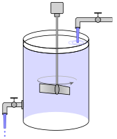

Continuando os estudos sobre outras aplicações das EDOs de primeira ordem a outras áreas, veremos hoje duas aplicações ligadas a Física, Química e às Engenharias.

## Lei do resfriamento de Newton

Na Termodinâmica, a lei de resfriamento de Newton diz que a taxa de variação da temperatura $T(t)$ de um corpo é proporcional à diferença entre a sua temperatura e a do ambiente que o rodeia ($T_A$). Isto nos fornece a equação diferencial $$\frac{dT}{dt}=k(T-T_A).$$

Este problema, assim como outros já trabalhados, é modelado por uma equação linear e separável. A solução constante $T=T_A$ corresponde a um objeto já à temperatura ambiente, ou seja, não haverá mudança ao longo do tempo. As soluções não constantes são dadas por $$\frac{dT}{dt}=k(T-T_A) \implies \dfrac{dT}{T-T_a}=k \ dt \implies \int \dfrac{dT}{T-T_a}= \int k \ dt \implies \ln |T-T_A|=kt+c$$ $$\implies T-T_A=Ce^{kt} \implies T=T_A+Ce^{kt},$$ em que $C$ é uma constante real não nula. Se temos a temperatura inicial $T_0$ do objeto, então temos que $T_0=T_A+C \implies C = T_0-T_A$ e, consequentemente a expressão geral é dada por $$T(t)=T_A+(T_0-T_A)e^{kt}.$$

::: {#exm-a13-1}
Quando um bolo é retirado do forno, sua temperatura é de 300$^{\circ}$F (aproximadamente 148,9$^{\circ}$C). Três minutos depois, sua temperatura passa para 200$^{\circ}$F (cerca de 93,3$^{\circ}$C). Quanto tempo levará para sua temperatura chegar a 95$^{\circ}$F (cerca de 35$^{\circ}$C) e possamos finalmente comê-lo, se a temperatura do ambiente em que ele for colocado for de exatamente 70$^{\circ}$F (aproximadamente 21,1$^{\circ}$C)?

Das informações da questão, temos que $T_A=70, T_0=300, T(3)=200$ e desejamos determinar o valor de $t$ para que $T(t)<95$. Podemos desenvolver a EDO que dá origem a este problema ou aplicar estes valores na solução encontrada. Optaremos pela segunda alternativa.

Substituindo os valores na equação, temos $$T(3)=70+230e^{3k}=200 \implies e^{3k}=\dfrac{13}{23}\implies e^{k}=\left({\dfrac{13}{23}}\right)^{1/3}.$$

Retornando à equação, temos $$T(t)=70+230(e^{k})^t=70+230\left({\dfrac{13}{23}}\right)^{t/3}.$$

Nosso objetivo é determinar o tempo para o qual a temperatura é menor que 95$^{\circ}F$, ou seja, determinar a solução da desigualdade $$70+230\left({\dfrac{13}{23}}\right)^{t/3}<95 \implies \left({\dfrac{13}{23}}\right)^{t/3} < \dfrac{25}{230} \implies \ln \left({\dfrac{13}{23}}\right) \cdot \dfrac{t}{3} < \ln \left({\dfrac{25}{230}}\right)$$

Observe que, na última desigualdade, os logaritmandos são números entre 0 e 1. Portanto, seus logaritmos são números negativos. Com isto, a desigualdade acima pode ser escrita como $$\ln \left({\dfrac{23}{13}}\right) \cdot \dfrac{t}{3} > \ln \left({\dfrac{230}{25}}\right) \implies t > \dfrac{3 (\ln 230-\ln 25)}{\ln 23-\ln 13} \approx 11,6689,$$ ou seja, após aproximadamente 11 minutos e 40 segundos.
:::

::: {#exr-a13-1}
Um termômetro é retirado de dentro de uma sala e colocado do lado de fora, em que a temperatura é de 5$^{\circ}$C. Após 1 minuto, o termômetro marcava 20$^{\circ}$C; após 5 minutos, 10$^{\circ}$C. Qual a temperatura da sala?
:::

::: {#exr-a13-2}
Um termômetro é removido de dentro de uma sala, em que a temperatura é de 70$^{\circ}$F, e colocado do lado de fora, em que a temperatura é de 10$^{\circ}$F. Após 30 segundos, o termômetro marcava 50$^{\circ}$F. Qual será a temperatura marcada no termômetro após 1 minuto da saída da sala? Quanto tempo levará para o termômetro marcar 15$^{\circ}$F?
:::

::: {#exr-a13-3}
Às 02h00 de um sábado, a perícia é chamada a um apartamento onde um homem foi encontrado sem vida. O ar-condicionado do cômodo manteve o ambiente a uma temperatura constante durante toda a noite de 20,5 °C. Ao chegar, o perito criminal mede a temperatura do corpo: 29,5 °C. Exatamente uma hora depois, às 03h00, faz nova medição: 27,25 °C.

As câmeras do prédio registraram dois suspeitos:

- Suspeito A: entrou no prédio às 21h30 e saiu às 22h50. Foi filmado em um bar a 15 km dali das 23h20 até as 02h00.
- Suspeito B: foi visto no centro da cidade às 23h00, entrou no prédio às 23h40 e saiu às 00h25.

Considere que a temperatura corporal da vítima no momento da morte era a habitual, 36,5 °C, e que o resfriamento segue a Lei de Newton. Estime a hora da morte e indique qual suspeito deve ser investigado com prioridade.
:::

Uma observação interessante sobre a prática forense: vários outros elementos influenciam a temperatura do corpo, como se a pessoa usava ou não roupas, a umidade e a ventilação do ambiente, a massa corporal, situações como febre ou hipotermia. Um modelo mais elaborado utilizado na prática é conhecido como [nomograma de Henssge](https://www.youtube.com/watch?v=2EYPW3Rmbms), cujo vídeo explicativo pode ser encontrado no YouTube.

## Misturas

Em modelos envolvendo misturas de dois fluidos, um tanque contendo um fluido começa a receber um segundo líquido a uma vazão constante; além disso, a mistura deste todos os fluidos é também eliminada na mesma vazão constante, conservando a quantidade de líquido no tanque. Caso nos perguntemos a concentração de determinando elemento diluído nos fluidos, a solução passará necessariamente por equações de primeira ordem.

Antes de prosseguirmos, é necessário revisar alguns conceitos associados para evitar confusão.

- A vazão é a razão entre o volume de entrada (ou saída) e o tempo em que isto aconteceu. Nos nossos modelos, é comum que sejam descritos em $L/min$;
- A concentração de um sal é razão entre sua massa e o volume no qual ele está dissolvido. Nos nossos modelos, costumam aparecer em $g/L$.

Assim, considere o seguinte problema em detalhe: num tanque de volume $V$ entra, com vazão $v$ (em $L/min$), um líquido com sal cuja concentração é de $k$ (em $g/L$); ao chegar no tanque, este líquido é misturado homogeneamente e, também com vazão $v$, essa mistura escoa. Considerando $S(t)$ como a massa do sal diluída no tanque, então a vazão de saída do sal é $S(t)/V$ (em $g/L$).

{.tikz fig-alt="Tanque cilíndrico com um misturador: uma torneira no alto despeja a solução com sal e outra torneira embaixo escoa a mistura."}

Logo, o modelo geral da taxa de variação desse sal em um instante $t$ é dada pela diferença entre a taxa de entrada do sal pela taxa de saída do sal, em $g/min$. E é justamente a unidade que nos fornece a dica de como obter ambas as taxas.

A taxa de entrada do sal é $vk$ $\dfrac{L}{min}\dfrac{g}{L}$, ou seja, $vk$ $g/min$, enquanto a de saída é $vS/V$ $\dfrac{L}{min}\dfrac{g}{L}$, isto é, $vS/V$ $g/min$.

Com isto, o modelo de equação para este problema é dado por $$\dfrac{dS}{dt}=vk-\dfrac{vS}{V},$$ que é uma equação separável e linear em $S$.

::: {#exr-a13-4}
Determine a solução constante da equação acima, explicando o que acontece no modelo nesta situação.
:::

Como a equação é linear, podemos resolver em três passos:

- $\displaystyle \int -\dfrac{v}{V} \ dt = -\dfrac{vt}{V}$
- $\displaystyle \int \dfrac{vk}{e^{-vt/V}} \ dt = vk \ \int e^{vt/V} \ dt = vk \ \dfrac{e^{vt/V}}{v/V} = kVe^{vt/V}$
- Portanto, a solução tem a forma $S(t)=e^{-vt/V} \left(kV e^{vt/V}+c\right)=kV+ce^{-vt/V}$, em que $c$ é uma constante real.

Caso tenhamos a informação inicial da quantidade de sal diluída no tanque $S_0=S(0)$, podemos determinar uma expressão geral para este problema.

$$S(0)=kV+ce^{-v\cdot 0/V} \implies S_0=kV+c \therefore c=S_0-kV.$$

Com isto, a expressão geral para o problema de misturas é $$S(t)=kV+(S_0-kV)e^{-vt/V},$$ em que $k$ representa a concentração de sal no fluido injetado no sistema $V$, o volume do tanque; $S_0$ a quantidade inicial de sal diluída no tanque; $v$ representa a vazão de entrada e saída do fluido.

::: {#exm-a13-2}
Inicialmente, 50 gramas de sal são dissolvidos em um tanque contendo 300 litros de água. Uma solução salina é bombeada para dentro do tanque a uma taxa de 3 litros por minuto, e a solução bem misturada é drenada na mesma taxa. Se a concentração da solução que entra é 2 gramas por litro, determine a quantidade de sal no tanque em qualquer instante. Quantos gramas de sal estão presentes após 50 minutos? E depois de um longo tempo?

Caso queiramos resolver este problema a partir da construção da EDO, basta repetir o procedimento realizado no modelo geral. Outra possibilidade é já substituir os valores adequados na expressão obtida anteriormente.

Dos dados fornecidos, obtemos $k=2, V=300, S_0=50$ e $v=3$, o que nos fornece a equação $$S(t)=600-550e^{-t/100}.$$ Para obter a massa de sal após 50 minutos, precisamos determinar $S(50)$. $$S(50)=600-550e^{-0,5}\approx 266,41,$$ ou seja, cerca de 266 gramas de sal. Com o tempo crescendo indefinidamente, $t$ tende a infinito e, consequentemente, $$\lim_{t \to \infty} S(t)=600-550 \cdot \lim_{t \to \infty} e^{-t/100} = 600-550 \cdot 0 = 600,$$ ou seja, a quantidade de sal se aproxima do limite de 600 gramas.
:::

::: {#exr-a13-5}
Considere o problema de misturas para o caso em que a vazão para a entrada e saída dos fluidos é de 10 $L/min$, em um tanque com 200 $L$ de uma mistura inicialmente com 100 $g$ de sal. Considere também que o líquido adicionado ao sistema tem concentração de 20 $g/L$ de sal.

a)  Determine a quantidade de sal $Q(t)$ em qualquer instante $t$.
b)  Para este problema, a quantidade de sal aumenta ou diminui com o passar do tempo?
c)  Determine a quantidade limite de sal presente no tanque após um período muito longo de tempo.
d)  Após quanto tempo a quantidade de sal no tanque é maior que 3 $kg$?
:::

::: {#exr-a13-6}
Um tanque contém 200 litros de fluido no qual são dissolvidos 30 g de sal. Uma solução salina contendo 1 g de sal por litro é então bombeada para dentro do tanque a uma taxa de 4 litros por minuto; a mistura é drenada à mesma taxa. Encontre a quantidade de gramas de sal $A(t)$ no tanque em qualquer instante.
:::

::: {#exr-a13-7}
Um tanque contém 200 litros de fluido no qual são dissolvidos 30 g de sal. Água pura é então bombeada para dentro do tanque a uma taxa de 4 litros por minuto; a mistura é drenada à mesma taxa. Encontre a quantidade de gramas de sal $A(t)$ no tanque em qualquer instante.
:::

::: {#exr-a13-8}
Um tanque está parcialmente cheio com 100 litros de fluido nos quais 10 g de sal são dissolvidos. Uma solução salina contendo 0,5 g de sal por litro é bombeada para dentro do tanque a uma taxa de 6 litros por minuto. A mistura é então drenada a uma taxa de 4 litros por minuto. Descubra quantos gramas de sal haverá no tanque após 30 minutos.
:::

::: {#exr-a13-9}
Suponha que glucose seja injetada na corrente sanguínea a uma taxa constante de $C$ gramas por minuto e, ao mesmo tempo, a glucose seja convertida e removida do organismo a uma taxa $k$ proporcional à quantidade de glucose presente. Construa a equação diferencial que modela este problema e a resolva.
:::
